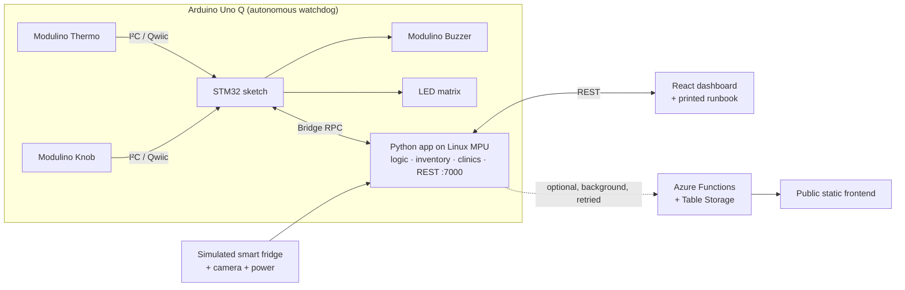

# ColdChain Rescue

> **Zero trust. Zero cloud. Zero vaccines lost.**

In November 2026, hackers remotely set supermarket fridges across seven
European countries, including Finland, to as much as 50 °C. Spoiled food costs
money. A hacked medicine fridge is worse: warm insulin and vaccines look
exactly the same, and a compromised screen can keep showing "4 °C" while the
stock gets used anyway.

**ColdChain Rescue puts an autonomous watchdog on every medicine fridge.** It
is an Arduino Uno Q with its own sensor, siren, LED display and knob, and it
never trusts the fridge. If the fridge's reported temperature disagrees with
the watchdog's own sensor, it raises a tamper alarm. It knows what is stored
inside, works out how long the most sensitive medicine stays safe, and ranks
nearby hospitals by drive time and free cold-storage space. All of this runs
on the board, so it keeps working with no internet, no cloud and no power
grid. The LED code matches a printed runbook, and a human always approves the
decision.

Built at **Junction 2026** (Espoo). Tracks: **Hardware · Healthcare · Agentic AI**.

---

## Why

- **Smart fridges get hacked.** A fridge that reports "4 °C, all fine" while
  it is actually warming is worse than one with no monitoring at all.
- **Temperature alone is not the answer.** What matters is *what is inside*
  and *how long it survives*. Insulin, vaccines and biologics each have their
  own storage range and their own maximum time out of the fridge.
- **The response is the hard part.** Data loggers exist. The hard part is who
  acts at 3 a.m., and where the stock can go, and whether that place has room.
- **Cloud and mains are single points of failure.** The moment a fridge fails
  is often the moment the network or the grid is also down.

## What it does

```
detect  ──►  alarm locally  ──►  work out the safe window  ──►  rank clinics  ──►  human approves
```

1. **Detect, independently.** The watchdog reads its own Modulino Thermo
   sensor and compares it with what the (simulated) smart fridge reports about
   itself. A mismatch above 2 °C means tamper (runbook code **H1**).
2. **Alarm locally.** Siren on the Modulino Buzzer, a warning sign and a
   protocol code on the LED matrix. No network needed.
3. **Know the stock.** The board holds the fridge inventory. The **safe
   window** is the shortest "max time out of fridge" among the medicines
   inside, and the dashboard names the limiting medicine.
4. **Pick the protocol.** A clinic is *reachable* if drive time plus 15 min of
   packing fits inside the safe window. The board lists reachable clinics by
   drive time with their free cold-storage capacity and selects **P1…P4**
   (critical, urgent, watch, pack on site).
5. **A human decides.** The operator acknowledges the alarm with the
   Modulino Knob at the fridge, follows the printed [runbook](docs/runbook.md)
   section that matches the LED code, and turns the knob again when the
   protocol is done. Nothing is decided for them.

### Zero trust: the fridge is never believed

The Uno Q has its own sensor and its own power. The simulated smart fridge
exposes the fields typical commercial units offer (screen temperature,
setpoint, door, compressor, defrost, power draw, online status). After
`hack_fridge` the screen keeps showing a calm temperature while the
controller defrosts, as in the 2026 supermarket attacks. The watchdog sees
the difference and raises H1. A compromised controller cannot hide a real
temperature rise. Readings are only alarm-relevant when the fridge holds
stock: an empty fridge cannot lose anything.

### Zero cloud: everything essential runs on the board

Detection, safe-window maths, clinic ranking, the alarm, the LED code, the
knob acknowledgement and the dashboard API (port 7000) all run on the Uno Q.
The Azure cloud backend is an optional extra for history and operator
visibility. Events are sent from a background thread with retries, and the
watchdog keeps working when the backend is unreachable.

### Zero vaccines lost: the runbook closes the loop

Every LED code (`P1`…`P4`, `H1`, doors warning) matches a section of the
printed [operator runbook](docs/runbook.md). The dashboard shows the same
section in large type, so screen and paper always agree.

> ⚠️ **Temperature readings alone cannot establish whether a medicine is still
> usable.** ColdChain Rescue flags excursions and supports the response. The
> decision to use, quarantine or discard stock stays with a pharmacist or
> other qualified person, following the manufacturer's guidance.

## Who it is for

Pharmacies, laboratories and smaller clinics: places with a few critical
fridges, no 24/7 facilities team, and a real need to know *who acts* when
something goes wrong at 3 a.m.

## Architecture



The solid lines are everything the demo needs. The dashed line is optional.

| Part | Tech | Role |
| --- | --- | --- |
| `device/coldchain-watchdog` | Arduino App Lab app for **Uno Q** (sketch + Python, WebUI brick) | Holds the fridge inventory and nearby clinics, reads the sensor, compares it with the simulated fridge, drives buzzer patterns and LED-matrix messages, handles knob acknowledgement, serves a REST API on port 7000, reports events to the cloud backend |
| `frontend` | **React + Vite + TypeScript**, Tailwind | Watchdog dashboard that talks directly to the board: live temperature, inventory, clinics (table and map), runbook panel, camera, collapsible simulate panel |
| `backend` | Python, **Azure Functions** (ASGI), Table Storage | Optional cloud backend: device-authenticated ingestion, incidents, history, public read APIs. See [backend/README.md](backend/README.md) and [backend/CLOUD_API.md](backend/CLOUD_API.md). `app.main:app` is the older local SQLite prototype |
| `static-frontend` | React + TypeScript + Vite | Public read-only demo of the cloud data (Finland map). See [static-frontend/README.md](static-frontend/README.md) |

The older data contracts and state machine are in
[docs/architecture.md](docs/architecture.md); the board's own behaviour is
described below.

### Alarm behaviour

```
unfreeze (stocked)   : blocked, operator notified, runbook check
power_outage         : siren, safe-window countdown, protocol P1..P4, clinic call list
doors_open           : "CLOSE THE DOORS" marquee + chime, ends on close or knob
hack_fridge (H1)     : |Arduino sensor - fridge screen| > 2 C -> siren + H1
knob x5 clockwise    : acknowledge (buzzer off, alarm stays open)
knob x5 clockwise    : resolve (protocol done); also resolves the cloud alert
```

For the demo the sketch shifts every Thermo reading by `DEMO_TEMP_OFFSET_C`
(currently -17 °C) so a room-temperature board behaves like a fridge. Set it
to `0.0` for real readings. A healthy fridge screen in the demo band is shown
as a steady 4.5 °C.

## Demo script (peer demo)

Full version: [docs/demo-script.md](docs/demo-script.md).

1. The dashboard shows the fridge holding insulin and vaccines (2–8 °C), the
   safe window and the nearby clinics ranked by drive time.
2. **Hack the fridge.** Its screen keeps saying 4.0 °C while it defrosts. The
   Arduino sensor disagrees: siren, `H1` on the LED matrix, runbook H1 on screen.
3. **Acknowledge with the knob** (5 clicks). The siren stops; the alarm stays open.
4. **Reset**, then **cut the power**. The safe window counts down, the board
   picks a protocol (P1 with the full inventory) and lists reachable clinics.
5. The operator follows the runbook, **turns the knob again**, and the stock is
   marked as moved.
6. **Doors open** shows the seatbelt-style warning, ended with a single knob turn.

## Repository layout

```
device/coldchain-watchdog/   Arduino App Lab app for the Uno Q
  app.yaml                   App Lab manifest (WebUI brick, port 7000)
  sketch/                    STM32 sketch: Thermo, buzzer patterns, LED matrix, knob
  python/main.py             Linux-side app: REST API, Bridge calls, event loop
  python/logic.py            command handling, safe window, clinic selection, protocol
  python/backend_stub.py     cloud backend client (log only unless BACKEND_ENABLED=1)
  python/.env                device keys for the cloud backend (gitignored, never commit)
  python/data/               medicines.json (inventory), clinics.json (main site + 10 clinics)
  assets/camera/             simulated fridge camera stills (960×540 JPEG), served at /camera/
  tests/                     unit tests for logic.py
backend/                     Azure Functions cloud backend (+ legacy local FastAPI prototype)
  function_app.py            Functions entry point; app/cloud/ holds the API
  seed/, tests/
frontend/                    React watchdog dashboard (talks to the board)
static-frontend/             public read-only demo frontend for the cloud data
docs/                        architecture, demo script, operator runbook (runbook.md)
scripts/deploy-device.sh     deploy the watchdog app to the Uno Q over adb
```

## Quick start

### Prerequisites

- Python 3.12+ and [uv](https://docs.astral.sh/uv/)
- Node.js 20+ and npm
- An Arduino **Uno Q** with Modulino Thermo, Modulino Buzzer and Modulino Knob chained on the
  Qwiic connector, connected to your computer over USB and to the same
  network as your computer (Wi-Fi)
- `adb` on your computer (`brew install android-platform-tools` on macOS).
  `arduino-app-cli` is already installed on the Uno Q.

Check that the board is visible:

```bash
adb devices
```

### 1. Deploy the watchdog to the Uno Q

```bash
./scripts/deploy-device.sh
```

The script stops any other running app, copies `device/coldchain-watchdog`
to `/home/arduino/ArduinoApps/coldchain-watchdog`, compiles and flashes the
sketch, starts the Python app and prints the board's API address, for
example `http://10.0.41.103:7000/api/state`. The board beeps once when the
sketch starts and the LED matrix shows the temperature.

To also follow the logs (including the payloads of the backend stubs):

```bash
./scripts/deploy-device.sh logs
```

Later, to see the logs without redeploying:

```bash
adb shell arduino-app-cli app logs user:coldchain-watchdog --follow
```

### 2. Run the dashboard

```bash
cd frontend
npm install
echo "VITE_BOARD_URL=http://<board-ip>:7000" > .env.local
npm run dev
```

Open <http://localhost:5173>. The dashboard talks directly to
the board: live temperature, inventory, nearby clinics, alarms and the
simulation buttons. If `VITE_BOARD_URL` is not set, the dashboard uses
`http://10.0.41.103:7000`. The nearby clinics card has a **Show map** button
that plots the fridge site and all clinics on an OpenStreetMap map (the map
tiles need internet on the laptop; the clinic table works offline).

### 3. Test the scenarios

Use the buttons in the dashboard, or call the board API directly:

```bash
curl -X POST http://<board-ip>:7000/api/command/power_outage
```

| Command | Fridge stocked | Fridge empty |
| --- | --- | --- |
| `unfreeze` (suspicious unfreeze) | Blocked: two groups of three beeps, matrix shows a warning sign and `CHECK`, operator notification stub | Allowed, only logged; the camera shows the empty fridge warming until `reset` |
| `power_outage` | Two-tone siren for 10 s, then a chirp every 5 s; matrix shows a warning sign and the protocol (`P1`…`P4`); dashboard shows the safe window countdown and clinics to call | No alarm; the camera shows the dark empty fridge until `reset` |
| `doors_open` | `CLOSE THE DOORS` marquee and seatbelt-style chime for 15 s | same |
| `hack_fridge` (simulate hacked fridge) | The simulated smart fridge goes into defrost but its screen stays at 4.0 °C. The board compares the fridge feed with the Arduino sensor; when they differ by more than 2 °C: siren, matrix shows a warning sign and `H1`, dashboard shows the mismatch (runbook **H1**) | No alarm (nothing at risk) |
| `empty` / `fill` | Empty the fridge or restore the full inventory | same |
| *knob: 5 clicks clockwise* | Operator acknowledges the alarm at the fridge: buzzer stops, confirmation chirp, matrix scrolls `ALARM ACK` then `ACK <code>`; dashboard turns the runbook panel green ("acknowledged"), alarm and countdown stay. Also ends the doors warning | No alarm: ignored |
| *knob: 5 clicks clockwise again* (after `ALARM ACK` has finished) | Protocol followed: alarm cleared, two beeps, matrix shows `DONE` then the temperature. For a power outage the stock has been moved to other clinics: the fridge is emptied (inventory synced) and stays without power until `reset` | — |
| `reset` | Operator clears alarms, buzzer stops, matrix shows the temperature | same |

The protocol numbers refer to the printed [operator runbook](docs/runbook.md).
While an alarm or the doors warning is active, the dashboard puts that runbook
section on top of the page: the numbered steps in large type, read from
`docs/runbook.md` at build time (so screen and printout always match), next to
the live call list, the sensor/fridge temperatures (H1) or the escalation time
(P3), and the knob instruction.
With the full demo inventory a power outage gives **P1**: the stock is safe
for 60 min and 4 clinics are reachable (drive time + 15 min packing).

Other read-only endpoints: `GET /api/state`, `GET /api/inventory`,
`GET /api/clinics`, and the camera stills at `GET /camera/<frame>.jpg`.

The sensor is not inside a real fridge, so the room temperature it measures
is shown and reported, but it does not trigger alarms on its own.

**Smart fridge feed (simulated).** The board also simulates a connected
fridge, with the fields typical smart fridges and commercial refrigeration
monitors expose: screen temperature, setpoint, door, compressor, defrost,
power draw and online status (`fridge` in `GET /api/state`). While healthy
the fridge screen follows the Arduino sensor. After `hack_fridge` it keeps
showing 4.0 °C while the controller defrosts (as in the 2026 supermarket
fridge attacks); the Arduino sensor keeps telling the truth, and the mismatch
triggers the **H1** alarm. `reset` restores the healthy fridge.

**Fridge camera (simulated).** The dashboard shows a "Fridge camera" panel
with a still that matches the board's state. The board picks the frame and
reports it as `camera` in `GET /api/state`
(`{"frame": "fridge_door_open", "url": "/camera/fridge_door_open.jpg", "simulated": true}`);
the dashboard only displays it. Each scene has a stocked and an empty
variant (`fridge_<scene>` / `fridge_empty_<scene>`), chosen from the
inventory, so `empty` and `fill` change the picture. First match wins:

| Scene | When |
| --- | --- |
| `power_outage` (dark, screen off) | power-outage alarm, or power still out after the outage was resolved |
| `door_open` | doors warning running (15 s, or until acknowledged with the knob) |
| `heating` (screen +12 °C) | suspicious-unfreeze alarm, or an allowed unfreeze of an empty fridge |
| `normal` (screen +4.5 °C) | everything else |

A hacked fridge looks normal on camera too: its screen shows a healthy
temperature, and only the Arduino sensor reveals the attack. An acknowledged
alarm keeps its frame until it is resolved or reset.

To change the pictures, replace the JPEGs in
`device/coldchain-watchdog/assets/camera/` (same names) and redeploy. For
example, from a 1672×941 PNG:

```bash
sips -s format jpeg -s formatOptions 80 --resampleWidth 960 fridge_normal.png --out device/coldchain-watchdog/assets/camera/fridge_normal.jpg
```

### Unit tests

```bash
uv run --no-project --with pytest pytest device/coldchain-watchdog/tests
```

```bash
cd backend && uv run pytest
```

### Cloud backend (optional)

For the Azure Functions backend (Azurite, `func start`, device keys) follow
[backend/README.md](backend/README.md); the public frontend is in
[static-frontend/](static-frontend/README.md). Tests: `cd backend && uv run pytest`.

### Legacy local backend

```bash
cd backend
uv sync
uv run uvicorn app.main:app --reload --host 0.0.0.0 --port 8000
```

API docs: <http://localhost:8000/docs>. The demo data in `seed/` loads on
first start.

The watchdog does not call this legacy backend. Every event goes through
`device/coldchain-watchdog/python/backend_stub.py`, which logs the JSON
envelope and, with `BACKEND_ENABLED=1`, POSTs it to the Azure cloud backend
(`backend/function_app.py`) with the `x-device-key` and `x-functions-key`
headers. Sends run on a background thread with retries, so a slow cold start
never blocks the alarm loop.

Device credentials live in `device/coldchain-watchdog/python/.env` (plain
`KEY=value` lines, loaded by `backend_stub.py`; real environment variables win).
The file is gitignored, `scripts/deploy-device.sh` pushes it to the board with
mode 600, and its values come from the private Arduino developer handoff, which
is gitignored too. Never commit keys or print request headers.

### Configuration

| Variable | Where | Default | Meaning |
| --- | --- | --- | --- |
| `VITE_BOARD_URL` | frontend | `http://10.0.41.103:7000` | Watchdog API on the Uno Q |
| `BACKEND_ENABLED` | device | `0` | `1` = backend stubs also POST their payloads |
| `COLDCHAIN_API_URL` | device | `http://localhost:8000` | Backend URL as seen from the board |
| `COLDCHAIN_DEVICE_ID` | device | `unoq-fridge-a` | Device identity |
| `COLDCHAIN_DEVICE_KEY` | device `.env` | none | Per-device key (`x-device-key`), secret |
| `COLDCHAIN_DEVICE_FUNCTION_KEY` | device `.env` | none | Device function key (`x-functions-key`), secret |
| `COLDCHAIN_DB_URL` | backend | `sqlite:///./coldchain.db` | Database |
| `COLDCHAIN_CORS_ORIGINS` | backend | `http://localhost:5173` | Allowed dashboard origins |
| `COLDCHAIN_TAMPER_TOLERANCE_C` | backend | `2.0` | Allowed device-vs-fridge difference |

### Troubleshooting

- **`adb devices` shows nothing:** reconnect the USB-C cable; use a data cable.
- **Dashboard says the board is unreachable:** check the IP printed by the
  deploy script and that your computer is on the same network.
- **Deploy fails with "port 7000 is declared by multiple sources":** don't add
  7000 to `ports` in `app.yaml`; the WebUI brick declares it.
- **No temperature / no beeps:** check the Qwiic chain. The sketch uses
  `Modulino.begin(Wire1)`, which is the Qwiic bus on the Uno Q.

## Scope and limits

- One watchdog, one monitored fridge, demo inventory and ten nearby clinics
  with drive times and cold-storage capacity
- Simulated: smart-fridge feed, fridge camera, power loss and the hack
- Local buzzer, LED code, knob acknowledgement and dashboard, all offline
- Optional cloud backend with device-key authentication

**Not in scope:** real fridge integration, real camera vision, regulatory-grade
logging, SMS/phone escalation, live traffic for drive times.

## Roadmap

- **Agentic planning** (Claude with tools) to draft and explain transfer
  plans and coordinate couriers, with a deterministic constraint checker and
  mandatory human approval staying authoritative
- Camera-based stock detection on the Uno Q
- Signed telemetry (HMAC) so spoofed readings are rejected
- Telegram / SMS / email escalation channels
- Battery-backed watchdog with a power-loss sensor on the fridge's mains

## Team

Junction 2026. See the commit history.

## License

[MIT](LICENSE)
