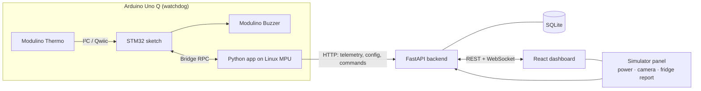

# ColdChain Rescue

> **The fridge is warming. Who needs to act, and where can the stock go?**

ColdChain Rescue coordinates the response to a failing medicine fridge. An
independent hardware watchdog sits next to the fridge. It detects temperature
excursions, power loss and tampering, sounds a local alarm, escalates to the
right people until someone acknowledges, and proposes a transfer of the stock
to available storage. The transfer respects explicit capacity limits and each
product's storage instructions, and a human approves it.

Built at **Junction 2026** (Espoo). Tracks: **Hardware · Healthcare · Agentic AI**.

---

## Azure backend

The new Azure Functions/Table Storage backend is separate from the original
SQLite prototype. See [backend setup and validation](backend/README.md) and
[cloud API contracts](backend/CLOUD_API.md). Run `function_app.py` through Functions
Core Tools for cloud behaviour; `app.main:app` remains the legacy local backend.
The existing frontend and device application are unchanged. The new static
frontend has its own `static-frontend/` directory and is not implemented yet.

## Why

- **Cold-chain failures are expensive and dangerous.** Vaccines, insulin,
  biologics and many reagents must stay within a narrow range (often
  +2 °C … +8 °C). A fridge that fails overnight can destroy thousands of euros
  of stock. Worse, the stock may still get used without anyone knowing.
- **Smart fridges get hacked.** Connected fridges in Europe have been reported
  compromised. A fridge that reports "4 °C, all fine" while it is actually
  warming is worse than one with no monitoring at all.
- **Monitoring alone is familiar.** Data loggers already exist. The hard part
  is the *coordinated response*: who is told, who confirms, where the stock
  goes, and whether that place has room and the right conditions.

## What it does

```
detect  ──►  alarm locally  ──►  escalate & acknowledge  ──►  plan transfer  ──►  human approves
```

1. **Detect.** The Uno Q watchdog reads its own temperature sensor every few
   seconds and evaluates it against the **storage range of the products
   actually in the fridge**.
2. **Alarm locally.** If the fridge holds stock and is outside the range for
   longer than the grace period, the on-board buzzer sounds. This works even
   when the network is down.
3. **Escalate & acknowledge.** The backend raises an alert on the dashboard.
   Staff acknowledge it, which silences the buzzer and records who took
   ownership.
4. **Plan a transfer.** If the cooling cannot be restored (for example, the
   power is out and the backup is not holding), ColdChain Rescue proposes
   moving the stock to alternative storage. It checks free capacity and
   whether each product's range is compatible with the target's range.
5. **Human approval.** Nothing moves until a person approves the plan.

### Independent watchdog & tamper detection

The Uno Q does **not** trust the fridge. It has its own sensor and its own
power, and it compares its reading with the temperature the (smart) fridge
reports about itself. If they disagree by more than a tolerance for a
sustained period, ColdChain Rescue raises a **TAMPER** alert in addition to
the normal excursion workflow. A compromised fridge controller cannot hide a
real temperature rise.

### Product instructions govern thresholds

Thresholds are **not** one global number. Every product carries its own
storage instructions (min/max °C, allowed excursion time). The fridge's
effective range is the intersection of the ranges of the products inside it.

> ⚠️ **Temperature readings alone cannot establish whether a medicine is still
> usable.** ColdChain Rescue flags excursions and supports the response. The
> decision to use, quarantine or discard stock stays with a pharmacist or
> other qualified person, following the manufacturer's guidance.

## Who it is for

Pharmacies, laboratories and smaller clinics: places with a few critical
fridges, no 24/7 facilities team, and a real need to know *who acts* when
something goes wrong at 3 a.m.

## Architecture



| Part | Tech | Role |
| --- | --- | --- |
| `device/coldchain-watchdog` | Arduino App Lab app for **Uno Q** (sketch + Python, WebUI brick) | Holds the fridge inventory and nearby clinics, reads the sensor, reacts to simulated events with buzzer patterns and LED-matrix messages, serves a REST API on port 7000, reports events through backend stubs |
| `backend` | Python 3.12+, **FastAPI**, SQLModel/SQLite | Collects telemetry, evaluates thresholds and tamper rules, manages alerts, inventory, capacity and transfer plans, pushes live updates |
| `frontend` | **React + Vite + TypeScript**, Tailwind, Recharts | Dashboard (fridges, live temperature, alerts, transfer plans) and the simulator panel used in the demo |

The detailed data contracts and state machine are in
[docs/architecture.md](docs/architecture.md).

### Alarm states

```
NORMAL ──out of range──► WARNING ──grace period elapsed & stock present──► EXCURSION
   ▲                                                                          │
   └──────────────── back in range (alert stays until acknowledged) ◄─────────┘

POWER_LOSS : fridge power reported down (simulated); escalates faster, triggers transfer planning
TAMPER     : |device reading − fridge-reported reading| > tolerance for a sustained period
```

## Demo script (peer demo)

Full version: [docs/demo-script.md](docs/demo-script.md).

1. The dashboard shows **Pharmacy Fridge A** holding insulin and vaccines
   (2–8 °C), plus two backup storage locations with explicit free capacity.
2. **Warm the sensor** (hold the Modulino Thermo in your hand). The temperature
   rises, WARNING appears, and then EXCURSION: **the buzzer sounds** and an
   alert pops up.
3. A staff member **acknowledges** the alert. The buzzer silences and the
   owner is recorded.
4. In the simulator, **cut the fridge power**. The state becomes POWER_LOSS
   and a **transfer plan** is proposed: what goes where, with capacity checked.
5. A pharmacist **approves** the plan.
6. **Tamper scenario:** the simulated smart fridge keeps reporting "4.0 °C"
   while the watchdog measures 12 °C. A **TAMPER** alert is raised.

## Repository layout

```
device/coldchain-watchdog/   Arduino App Lab app for the Uno Q
  app.yaml                   App Lab manifest (WebUI brick, port 7000)
  sketch/                    STM32 sketch: Modulino Thermo, buzzer patterns, LED matrix
  python/main.py             Linux-side app: REST API, Bridge calls, event loop
  python/logic.py            command handling, safe window, clinic selection, protocol
  python/backend_stub.py     calls to the future backend (log only by default)
  python/data/               medicines.json (inventory), clinics.json (main site + 10 clinics)
  tests/                     unit tests for logic.py
backend/                     FastAPI service
  app/api/                   HTTP + WebSocket routes
  app/domain/                thresholds, tamper check, alarm state machine, transfer planner
  app/agent/                 (planned) agentic escalation & planning
  seed/                      demo products, storage locations, stock
  tests/
frontend/                    React dashboard + simulator
docs/                        architecture, demo script, operator runbook (runbook.md)
scripts/dev.sh               run backend + frontend together
scripts/deploy-device.sh     deploy the watchdog app to the Uno Q over adb
```

## Quick start

### Prerequisites

- Python 3.12+ and [uv](https://docs.astral.sh/uv/)
- Node.js 20+ and npm
- An Arduino **Uno Q** with Modulino Thermo and Modulino Buzzer chained on the
  Qwiic connector, connected to your computer over USB and to the same
  network as your computer (Wi-Fi)
- `adb` on your computer (`brew install android-platform-tools` on macOS).
  `arduino-app-cli` is already installed on the Uno Q.

Check that the board is visible:

```bash
adb devices
```

### 1. Deploy the watchdog to the Uno Q

```bash
./scripts/deploy-device.sh
```

The script stops any other running app, copies `device/coldchain-watchdog`
to `/home/arduino/ArduinoApps/coldchain-watchdog`, compiles and flashes the
sketch, starts the Python app and prints the board's API address, for
example `http://10.0.41.103:7000/api/state`. The board beeps once when the
sketch starts and the LED matrix shows the temperature.

To also follow the logs (including the payloads of the backend stubs):

```bash
./scripts/deploy-device.sh logs
```

Later, to see the logs without redeploying:

```bash
adb shell arduino-app-cli app logs user:coldchain-watchdog --follow
```

### 2. Run the dashboard

```bash
cd frontend
npm install
echo "VITE_BOARD_URL=http://<board-ip>:7000" > .env.local
npm run dev
```

Open <http://localhost:5173>. The **Fridge watchdog** tab talks directly to
the board: live temperature, inventory, nearby clinics, alarms and the
simulation buttons. If `VITE_BOARD_URL` is not set, the dashboard uses
`http://10.0.41.103:7000`.

The **Backend dashboard (legacy)** tab needs the FastAPI backend (see
below). The watchdog does not need it.

### 3. Test the scenarios

Use the buttons in the dashboard, or call the board API directly:

```bash
curl -X POST http://<board-ip>:7000/api/command/power_outage
```

| Command | Fridge stocked | Fridge empty |
| --- | --- | --- |
| `unfreeze` (suspicious unfreeze) | Blocked: two groups of three beeps, matrix shows a warning sign and `CHECK`, operator notification stub | Allowed, only logged |
| `power_outage` | Two-tone siren for 10 s, then a chirp every 5 s; matrix shows a warning sign and the protocol (`P1`…`P4`); dashboard shows the safe window countdown and clinics to call | Nothing to do |
| `doors_open` | `CLOSE THE DOORS` marquee and seatbelt-style chime for 15 s | same |
| `empty` / `fill` | Empty the fridge or restore the full inventory | same |
| `reset` | Operator clears alarms, buzzer stops, matrix shows the temperature | same |

The protocol numbers refer to the printed [operator runbook](docs/runbook.md).
With the full demo inventory a power outage gives **P1**: the stock is safe
for 60 min and 4 clinics are reachable (drive time + 15 min packing).

Other read-only endpoints: `GET /api/state`, `GET /api/inventory`,
`GET /api/clinics`.

The sensor is not inside a real fridge, so the room temperature it measures
is shown and reported, but it does not trigger alarms.

### Unit tests

```bash
uv run --no-project --with pytest pytest device/coldchain-watchdog/tests
```

```bash
cd backend && uv run pytest
```

### Backend (optional, legacy dashboard)

```bash
cd backend
uv sync
uv run uvicorn app.main:app --reload --host 0.0.0.0 --port 8000
```

API docs: <http://localhost:8000/docs>. The demo data in `seed/` loads on
first start. `./scripts/dev.sh` runs the backend and the dashboard together.

The watchdog does not call this backend yet: every event goes through
`device/coldchain-watchdog/python/backend_stub.py`, which logs the JSON
payload. Set `BACKEND_ENABLED=1` and `COLDCHAIN_API_URL` on the device to
also POST it once the backend has matching endpoints.

### Configuration

| Variable | Where | Default | Meaning |
| --- | --- | --- | --- |
| `VITE_BOARD_URL` | frontend | `http://10.0.41.103:7000` | Watchdog API on the Uno Q |
| `VITE_API_URL` | frontend | `http://localhost:8000` | Backend URL (legacy tab) |
| `BACKEND_ENABLED` | device | `0` | `1` = backend stubs also POST their payloads |
| `COLDCHAIN_API_URL` | device | `http://localhost:8000` | Backend URL as seen from the board |
| `COLDCHAIN_DEVICE_ID` | device | `unoq-fridge-a` | Device identity |
| `COLDCHAIN_DB_URL` | backend | `sqlite:///./coldchain.db` | Database |
| `COLDCHAIN_CORS_ORIGINS` | backend | `http://localhost:5173` | Allowed dashboard origins |
| `COLDCHAIN_TAMPER_TOLERANCE_C` | backend | `2.0` | Allowed device-vs-fridge difference |

### Troubleshooting

- **`adb devices` shows nothing:** reconnect the USB-C cable; use a data cable.
- **Dashboard says the board is unreachable:** check the IP printed by the
  deploy script and that your computer is on the same network.
- **Deploy fails with "port 7000 is declared by multiple sources":** don't add
  7000 to `ports` in `app.yaml`; the WebUI brick declares it.
- **No temperature / no beeps:** check the Qwiic chain. The sketch uses
  `Modulino.begin(Wire1)`, which is the Qwiic bus on the Uno Q.

## Weekend scope

- One sensor, one monitored fridge, two alternative storage locations
- Explicit capacity constraints and per-product storage ranges
- Local buzzer + dashboard alerts with acknowledgement
- Simulated power loss, simulated camera ("stock present") and simulated
  smart-fridge self-reports
- Transfer proposal with mandatory human approval

**Not in scope:** real fridge integration, real camera vision, regulatory-grade
logging, SMS/phone escalation.

## Roadmap

- **Agentic escalation & planning** (Claude with tools): run the escalation
  ladder, draft and explain transfer plans and coordinate couriers. A
  deterministic constraint checker stays authoritative.
- Camera-based stock detection on the Uno Q
- Signed telemetry (HMAC) so spoofed readings are rejected
- Telegram / SMS / email escalation channels
- Battery-backed watchdog with a power-loss sensor on the fridge's mains

## Team

Junction 2026. See the commit history.

## License

[MIT](LICENSE)
