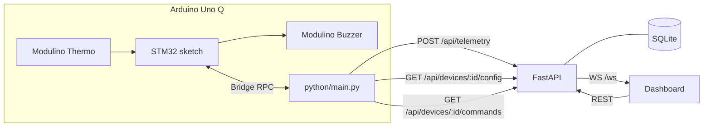

# Architecture

## Components



### Uno Q split

| Side | Code | Responsibility |
| --- | --- | --- |
| STM32 MCU (Zephyr) | `sketch/sketch.ino` | Reads the Modulino Thermo and drives the Modulino Buzzer. Exposes Bridge functions `read_temp()` and `set_alarm(bool)` |
| Linux MPU (Debian) | `python/main.py` | Loops every few seconds: calls `read_temp` over Bridge, evaluates the **local alarm rule** with the last cached config, calls `set_alarm`, sends telemetry and polls for commands |

The local alarm rule runs **on the device** with a cached copy of the
config (range, grace period, stock present). The buzzer works even when the
backend is unreachable.

## Data contracts

### Device → backend

`POST /api/telemetry`

```json
{ "device_id": "unoq-fridge-a", "ts": "2026-11-14T10:00:00Z", "temp_c": 5.2, "seq": 42, "alarm_active": false }
```

`GET /api/devices/{device_id}/config`

```json
{ "device_id": "unoq-fridge-a", "location_id": "fridge-a", "min_c": 2.0, "max_c": 8.0,
  "grace_seconds": 30, "stock_present": true, "silenced": false }
```

`GET /api/devices/{device_id}/commands` returns pending commands and marks
them delivered:

```json
[{ "id": 7, "command": "silence" }]
```

Commands: `silence`, `unsilence`, `test_alarm`.

### Simulator → backend

| Route | Body | Effect |
| --- | --- | --- |
| `POST /api/sim/fridge-report` | `{location_id, temp_c}` | What the smart fridge *claims*; used for the tamper check |
| `POST /api/sim/power` | `{location_id, on}` | Mains power of the fridge |
| `POST /api/sim/camera` | `{location_id, stock_present}` | Simulated camera occupancy |
| `POST /api/telemetry` | as above | Fake device readings when no board is attached |

### Dashboard

| Route | Purpose |
| --- | --- |
| `GET /api/inventory` | Locations with capacity, stock and products |
| `GET /api/readings?location_id=&limit=` | Recent readings |
| `GET /api/alerts` / `POST /api/alerts/{id}/ack` | Alerts and acknowledgement (`{by}`) |
| `POST /api/transfers/propose` | `{source_location_id}` → proposed plan |
| `POST /api/transfers/{id}/approve` | `{by}` → approved plan |
| `WS /ws` | Pushes `{type: "reading" \| "alert" \| "state" \| "transfer", data}` |

## Thresholds

Each product has `min_c`, `max_c` and `max_excursion_minutes` taken from its
storage instructions. A location's effective range is the **intersection**
of the ranges of the products it currently holds. If it holds nothing, there
is no excursion alarm (the reading is still logged).

## Alarm state machine

| State | Entered when |
| --- | --- |
| `NORMAL` | Reading within the effective range |
| `WARNING` | Out of range, grace period not yet elapsed, or no stock present |
| `EXCURSION` | Out of range for longer than the grace period **and** stock present |
| `POWER_LOSS` | Fridge power reported off while stock is present |
| `TAMPER` | \|device reading − fridge self-report\| > tolerance (default 2 °C) |

`TAMPER` is evaluated alongside the others; it raises its own alert.

## Transfer planner

Deterministic and authoritative. For each stock item at the source, it picks
a target location that (a) has a range that fits inside the product's range,
(b) has enough free capacity, and (c) is powered. Items that cannot be placed
are listed as `unplaced`. The plan stays `proposed` until a human approves
it. The planned agentic layer may *suggest* and *explain*, but plans are
always validated by this planner.
